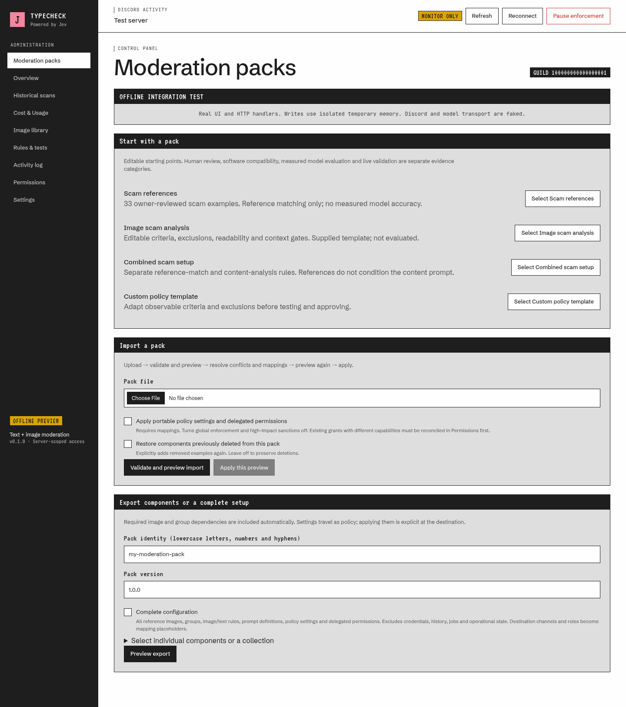
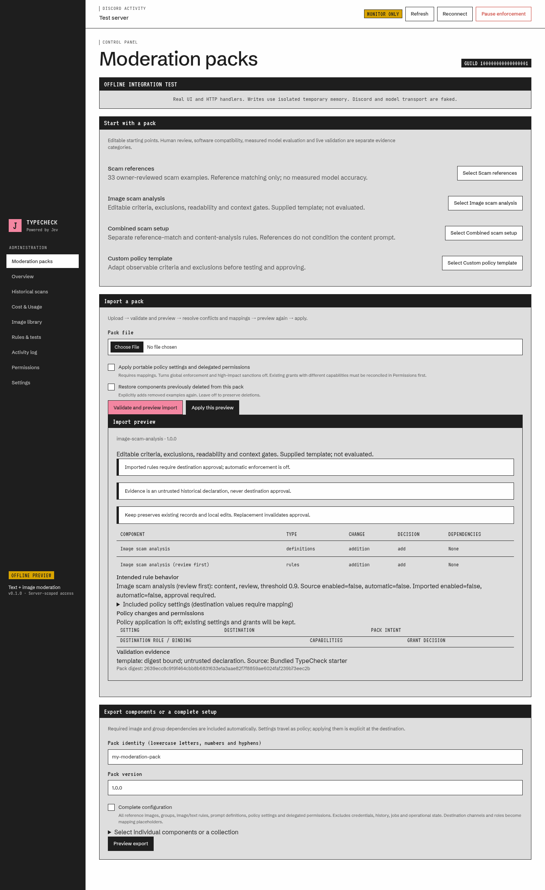
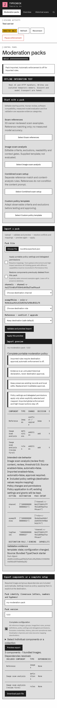

# Reusable moderation packs

Administrators open **Moderation packs** in the Activity. Select a starter or upload a `.typecheck.json` file, validate it, inspect the preview, resolve conflicts and any destination mappings, preview again, then apply. Importing a selection preserves unrelated records. Nothing is deployed by importing or publishing a pack.

## Export and complete configuration

Select an individual image, group, standalone image-analysis definition, rule, or any collection. **Preview export** resolves dependencies and lists the exact included components before **Download pack file**. A selected group includes its members. An individual grouped image includes its group container without unrelated siblings; a rule includes its individual reference, group members, or entire reference library for an any-reference rule. Content/text rules embed their parsed definitions; reference images do not condition content-analysis prompts. Exports capture the policy and asset bytes under the guild transaction lock.

**Complete configuration** includes all groups, reference images (including disabled records), saved image-analysis definitions, image and native text rules, the policy settings below and delegated capability grants. This is the complete *portable moderation policy*, not a database backup.

Included settings: monitoring and global enforcement intent; any-image, semantic and text-mode intent; message-context opt-in; channel scopes/exclusions; role exemptions; bot/webhook processing; log channel and DM notification policy; action floors, call budget, retention policy, uncertainty behavior, high-impact intent and pinned model. Source enforcement intent is shown but cannot confer destination authority. Channel IDs, role IDs and delegated-role targets become portable binding placeholders. Notification text is currently the rule reason; there is no separate notification-template subsystem. Destination bot credentials, server installation, Discord permission overwrites, member identities, guild ownership and role hierarchy are never transferred.

Excluded: credentials/tokens/master keys, OAuth/session state, personal moderation history, calibration samples/trials, evaluations, jobs, scans, queues, usage/cost ledgers, sanctions/action receipts, audit history, leadership/limiter state, database IDs, object paths and first-login/text-starter installation markers. Administrator-authored names, prompts and reasons are included: review these free-text fields before sharing confidential policy.

## Conflict, repeat and upgrade behavior

An import receipt tracks pack/component identities, installed record IDs and local baselines. Same identities are kept by default, including locally edited components and newer pack versions. Replacement is an explicit per-component choice; replacing a rule clears its approval and disables it. Different identities add components rather than overwrite records with a similar name. Exact normalized image digests are adopted to avoid duplicate references. Adoption preserves destination names, enabled state and group membership; the preview calls it a conflict. A partial import can therefore preserve a different destination layout. Choose replacement explicitly when the pack layout is intended. A group rule is visibly skipped if a kept reference belongs to another destination group; this prevents creating a rule with silently missing members.

Previously imported and subsequently deleted components remain deleted. Dependent components are visibly skipped when their required dependency remains deleted. **Restore components previously deleted** explicitly restores them. First-login reference seeding writes the same tombstone identities; older installations are recognized from the existing seed audit event and normalized assets. This supports existing guilds without resetting their settings or restoring deleted examples on sign-in. Audit-based recognition on older installations depends on retention of the original seed event; when that event is absent, already present assets are still deduplicated, but missing legacy assets cannot be distinguished from never-installed examples.

Saved standalone definitions can be edited or used to create an image-content rule. Rules contain independent definition snapshots: editing the saved definition does not silently change a rule. Export the changed rule to distribute that change.

Policy settings and delegated grants are included with exports but applied only when explicitly selected. Map every channel/role placeholder to a current destination object. Channel access is checked for both administrator and bot. Existing grants with different capabilities block policy application and must be reconciled through Permissions first; imports never silently replace delegated permissions. Grants cannot assign administrator-only capabilities. Role/channel names are not trusted as identity. Intended actions, thresholds and source settings remain visible in preview; imported rules always have `enabled=false`, `automatic=false`, `approval=null`. Applied global policy always has enforcement and high-impact sanctions off. Existing untouched rules keep their state; selected-component import does not pause unrelated moderation.

After import, configure channels and credentials, review definitions/actions, run representative positive and negative tests, obtain current destination rule approval, then separately enable rules/automatic enforcement through the normal gates. Severe sanctions still require second verification, Discord permissions/hierarchy and deployment acceptance.

## Format v1

The UTF-8 JSON container has `format: "typecheck-pack-v1"`. It is intentionally not ZIP/tar: no archive paths, links, compression, extraction or embedded executable code exist. Asset data is base64-encoded *actual file bytes*, not network URLs. IDs match `[a-z][a-z0-9-]{0,79}` and are scoped to a pack; source database IDs and object paths are not portable references.

| Field | Meaning |
|---|---|
| `id`, `version`, `description` | Stable pack identity, publisher version and plain-language scope. Preserve identity across upgrades. |
| `compatibility` | App `0.1.0`, schema `004`, `image-content-v1` prompt protocol, pinned Jev model and normalization build version. Unknown app/schema/prompt versions are rejected. Embedded text definitions also carry their own parser version. |
| `provenance` | Declared source and redistribution status. These are not authenticated ownership or licensing assertions. |
| `components[]` | Unique portable `id`, `kind`, `name`, explicit `dependencies[]`, typed `value`. Kinds: groups, images, definitions, rules. |
| `assets[]` | Unique portable ID, exact raw-byte SHA-256, canonical base64. Optional `normalized` identifies an exported normalized JPEG build. |
| `policy` | Settings, channel/role bindings and delegated grants, or null. Bindings contain portable ID, kind and purpose. |
| `evidence[]` | Typed historical declarations with configuration digest, source and bounded details. |

Group values are empty objects. Image values contain `asset`, `groupId` (portable or null), `enabled`. Definition values contain `content`, validated by `parseContent`. Rule values follow `parseRule` except `name` is on the component and reference/group IDs are portable dependencies. Approval is forbidden. Content and text definitions remain embedded in rules; importing a definition alone creates no executable rule. See [shared types](../shared/packs.ts), [domain parsers](../shared/domain.ts) and the self-contained [custom sample](../starters/custom-template.typecheck.json).

Original assets are decoded with the existing bounded image parser and normalized locally. Exported normalized JPEGs from the same normalization build are fully decoded, checked for the expected 768-square JPEG dimensions and absence of metadata, then retained byte-for-byte to preserve exact matching. Other normalization builds are normalized again, with an explicit warning and no inherited approval. Asset SHA-256 covers original embedded bytes, not the normalized comparison hash. Unknown fields, unsupported versions, duplicate identifiers, dangling/missing required dependencies, invalid rule/settings/content/text definitions, corrupt assets and checksum mismatches fail validation.

Limits: 48 MiB JSON container, 32 MiB decoded assets, 250 assets, 1,000 components, 1,000 mapping slots, 50 evidence entries (20,000 bytes each), 100,000 structural nodes and 32 nesting levels. Each image is limited to 8 MiB and 24 million pixels; supported nonanimated JPEG/PNG/WebP/GIF only. Existing normalization concurrency/waiting-room limits apply. No model calls occur during validation or import. Destination group/image/rule/definition limits remain 100/250/250/250.

## Evidence and status

`template`, `human_review`, `software`, `model_evaluation` and `live` are distinct evidence categories. None automatically grants a “verified” status. All imported claims remain **untrusted historical declarations**, including claims naming external tests or live environments. TypeCheck checks manifest/asset integrity and the digest binding, not the truth of submitted accuracy claims or authenticity of their source.

The configuration digest is SHA-256 of canonical JSON for the entire container with `evidence: []`. Canonical JSON recursively sorts object keys and preserves array order; JSON encoding uses no whitespace. Embedded asset hashes, compatibility versions, model, prompts, thresholds, normalization, mappings and source settings are consequently bound. Any change to these fields makes existing evidence visibly stale in preview. Evidence entries have `{kind, digest, source, details}`. Actual measured evidence should include exact component/asset digests, app/model/prompt/threshold/normalization versions, dataset provenance and tuning/held-out split, sample counts, false positives/negatives, abstentions, coverage, date, environment, limitations and supporting evidence source. Missing data must remain unknown. Do not describe synthetic fixtures or reviewed positive images as measured accuracy.

Imported-pack history separately shows when destination records or applied policy settings have changed since the import baseline. It does not revalidate an external evidence source, and kept/locally edited components do not acquire validation from a new pack version. Audit receipts record the attempted pack digest and historical declarations; the pack manifest is not an executable approval certificate.

## Bundled starters

| Starter | Contents and actual status |
|---|---|
| Scam references | 33 original owner-supplied images, reviewed by the owner as scams on 2026-10-17; one group. Human labels only; not exclusively crypto-labeled, no negative/held-out set, no measured accuracy. |
| Image scam analysis | Existing editable scam criteria, exclusions, speaker/context and readability gates; standalone definition plus disabled review rule. Supplied template, not model-evaluated. |
| Combined scam setup | Reference collection plus separate disabled reference-match and image-content review rules and saved definition. References do not condition the content prompt. |
| Custom policy template | Editable observable-policy definition and disabled review rule. Replace criteria/exclusions and test before approval. |

All four use the same validator, preview and import API as uploaded packs. Original images and source manifests remain in [data/scams](../data/scams/README.md); the checked-in packs embed those bytes unchanged. Owner review does **not** establish redistribution rights. The code's MIT license does not grant image rights. Keep the provenance with internal transfers and establish rights separately before redistributing supplied images.

Generate samples after compiling: `node scripts/build-starter-packs.mjs`. The API constructs starters against the installed codec version; checked-in samples record the build that generated them, so a codec difference is an honest compatibility warning.

## Atomicity, recovery and operations

Preview is read-only for policy. Its ten-minute MAC binds guild, actor, complete input (including evidence), selected decisions, mappings and destination policy snapshot. Apply revalidates input and live authority/permissions, then acquires the existing guild transaction lock and compares the snapshot. Any concurrent configuration edit invalidates the preview. The purpose-separated MAC uses the shared application vault key, so previews work across replicas and restarts. Key rotation invalidates outstanding previews. Uploaded files are not persisted by preview.

Database changes, references, settings, grants, import receipts and audit records commit together on both PostgreSQL and MySQL. A filesystem failure rolls back configuration. Content-addressed files written before a later database failure are safe orphans. Existing hourly leader maintenance removes unreferenced objects older than 24 hours; young files are retained to protect concurrent uploads. Failed imports also attempt that conservative collection. Never delete an object merely because one transaction failed: another reference may share it. Filesystem/database backups remain required; packs are not disaster recovery backups and deliberately exclude operational state.

Migration **004** adds constrained JSON record tables `pack_definitions` and `moderation_packs`; it is additive and restartable. Back up before migration using the established runtime backup procedure. PostgreSQL uses the existing migration transaction; MySQL uses the existing named lock, pre-migration backup hook and receipt. Existing data and first-sign-in behavior are retained. Roll back application code without dropping these tables. No production migration is authorized by this feature's publication.

## Workflow images

Actual Activity screenshots from the offline integration harness (real HTTP handlers and writes to temporary memory; faked guild/Discord/model transports). These prove only the local workflow and layout, not live Discord, model accuracy or deployment.

See [validation record](PACK_VALIDATION.md) for commands, backend checks and remaining acceptance.
